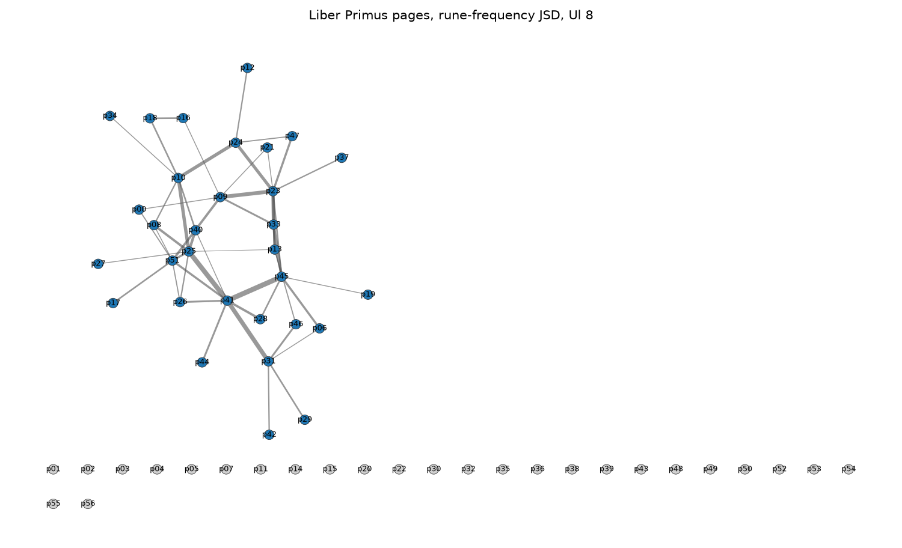

# Rank-based linkage on the unsolved Liber Primus pages

Fork-only example (not intended for upstream). Data: `dataset/liber_primus.json` from
github.com/Dukotah/cicada3301 (57 page segments of the unsolved Liber Primus, 12,956 runes, 29-rune alphabet).

Question: do the pages fall into groups by rune frequency (for example, groups enciphered with
different keys), beyond what sampling noise alone produces?

Method:
- `page_graph.py` summarises each page by its distribution over the 29 runes and writes the complete
  graph on the 57 pages with weight = Jensen-Shannon divergence (bits). Lower is more similar: mode `Ul`.
- `rbl.jar pages.csv Ul 8` gives the sub-critical linkage subgraph.
- Null model (`--shuffle SEED`): pool all runes, shuffle, deal back into pages of the original lengths.
  Same page lengths, no structure except sampling noise.
- `run.sh rbl.jar liber_primus.json 20` runs the real pages and 20 null replicates and prints the
  summary from `tools/visualize/rbl_visualize.py`.

Result (run 2026-11-17, JDK 21, `Ul 8`):

| | links | components | largest component | isolated pages | in-sway range |
|---|---|---|---|---|---|
| real pages | 51 | 1 | 31 | 26 | 16..34 |
| 20 null replicates, min..max | 49..56 | 1..2 | 26..34 | 23..31 | low end 13..17, high end 30..44 |

Every statistic of the real pages lies inside the range of the 20 shuffled replicates. Rank-based
linkage finds no page grouping by rune frequency that sampling noise does not also produce. That is
consistent with the cicada3301 repo's finding that the ciphertext is one-time-pad-class. This is a negative
result about the data. Note that the shuffled replicates also produce a linkage subgraph with a large
component: the null replicates are the baseline that any claimed grouping of pages would need to beat.

